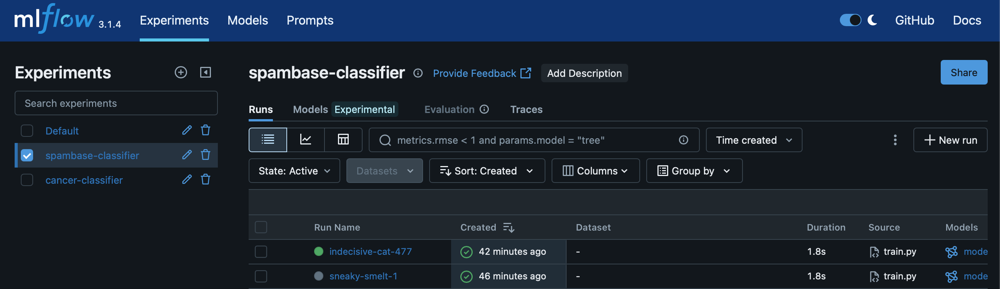
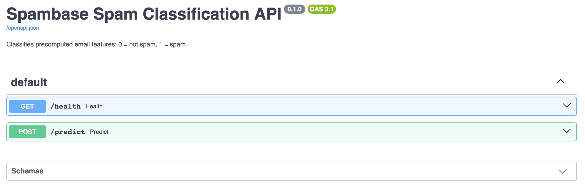
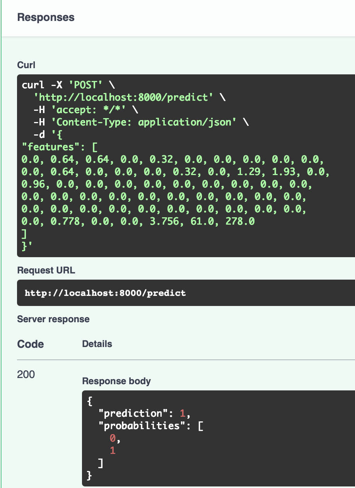

# Spam Classification: Training and Serving

A spam classifier trained on UCI Spambase, with MLflow for tracking runs and a
FastAPI service for predictions. The service can run locally or in Docker.

## Quick start

Use Python 3.11 to match the Docker image. From the project root:

```sh
python3 -m venv .venv
source .venv/bin/activate
python -m pip install -r requirements.txt
python src/train.py
uvicorn src.app:app --reload
```

Training downloads the dataset, so it needs an internet connection. On Windows
PowerShell, replace the activation command with `.venv\Scripts\Activate.ps1`.

Open http://127.0.0.1:8000/docs to try the API. Stop the server with Ctrl+C.

## Dataset and training

[UCI Spambase](https://archive.ics.uci.edu/dataset/94/spambase) contains 4,601
emails with 57 numeric features: word frequencies, character frequencies, and
capital-letter statistics. The original email text is not included.

- `0`: not spam
- `1`: spam

The model is a Random Forest with 100 trees, trained on a stratified 80/20 split.
Training prints test accuracy and saves the model to
[artifacts/model.joblib](artifacts/model.joblib). Retraining replaces that file.

To retrain:

```sh
python src/train.py
```

MLflow keeps a separate record of each run in `mlruns/`, under the experiment
`spambase-classifier`. It logs the dataset name, model parameters, test accuracy, and
model, along with an example input and model signature.

## View experiments

In a second terminal:

```sh
source .venv/bin/activate
mlflow ui --backend-store-uri ./mlruns
```

Open http://127.0.0.1:5000 and select `spambase-classifier` to compare runs.



## API

| Endpoint | Purpose |
| --- | --- |
| `GET /health` | Returns `{"status": "ok"}`. |
| `POST /predict` | Accepts 57 features and returns a class and probabilities. |
| `GET /docs` | Interactive API documentation. |

Train the model before starting the API. Prediction requests take 57 numbers in
the original Spambase column order (`feature_0` through `feature_56`), not email
text.



### Sample request

Open `POST /predict` in `/docs`, click **Try it out**, and paste this sample.
Its label in the dataset is `1` (spam).

```json
{
	"features": [
		0.0, 0.64, 0.64, 0.0, 0.32, 0.0, 0.0, 0.0, 0.0, 0.0,
		0.0, 0.64, 0.0, 0.0, 0.0, 0.32, 0.0, 1.29, 1.93, 0.0,
		0.96, 0.0, 0.0, 0.0, 0.0, 0.0, 0.0, 0.0, 0.0, 0.0,
		0.0, 0.0, 0.0, 0.0, 0.0, 0.0, 0.0, 0.0, 0.0, 0.0,
		0.0, 0.0, 0.0, 0.0, 0.0, 0.0, 0.0, 0.0, 0.0, 0.0,
		0.0, 0.778, 0.0, 0.0, 3.756, 61.0, 278.0
	]
}
```

The response contains a `prediction` (`0` or `1`) and `probabilities`, ordered
as `[not spam, spam]`. 

Missing features, nonnumeric values, or a list with the wrong length return
HTTP `422`.



## Tests

After training, run:

```sh
python -m pytest -v
```

The tests check the health endpoint, prediction format, probabilities, and input
validation. They call the app directly with `TestClient`; you don't need to start
a server or container. They check API behavior, not model accuracy.

## Docker

Start Docker Desktop (or a Docker engine) and train the model before building.
The image includes the source and exported model.

```sh
docker build -t mlops-demo:local .
docker run --rm --name mlops-demo -p 127.0.0.1:8000:8000 mlops-demo:local
```

Open http://127.0.0.1:8000/docs. Stop the container with Ctrl+C, or run
`docker stop mlops-demo` in another terminal. `--rm` removes the container after
it stops, but keeps the image.

Rebuild the image and replace the container after changing the source or
retraining. The image contains a copy of the model, not a live link to it.
The local virtual environment and MLflow history are excluded from the build.

## Project layout

```text
src/
	train.py          Download data, train, evaluate, and log to MLflow
	app.py            Load the model and serve predictions
tests/
	test_api.py       API contract and validation tests
artifacts/          Exported model, generated by training
mlruns/             Local experiment history, generated by MLflow
requirements.txt    Python dependencies
Dockerfile          Container build instructions
.dockerignore       Files excluded from the Docker build context
```

## Scope and next steps

This project focuses on the ML training-to-serving workflow: experiment tracking, model persistence, API validation, automated testing, and containerized inference. It uses precomputed Spambase features and runs locally, with cloud deployment and production monitoring left as future extensions.
